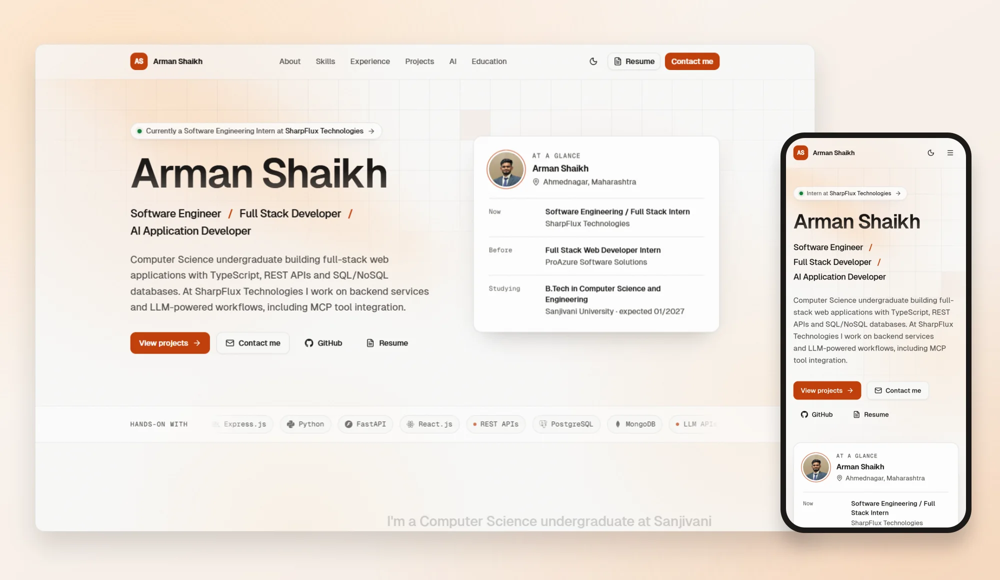
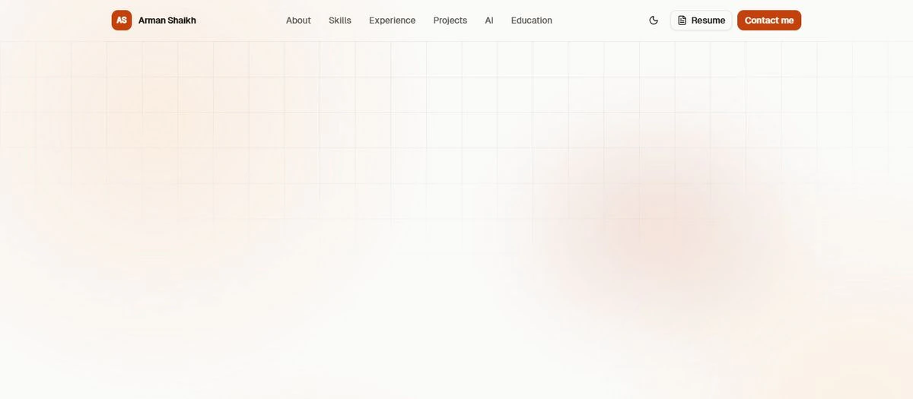
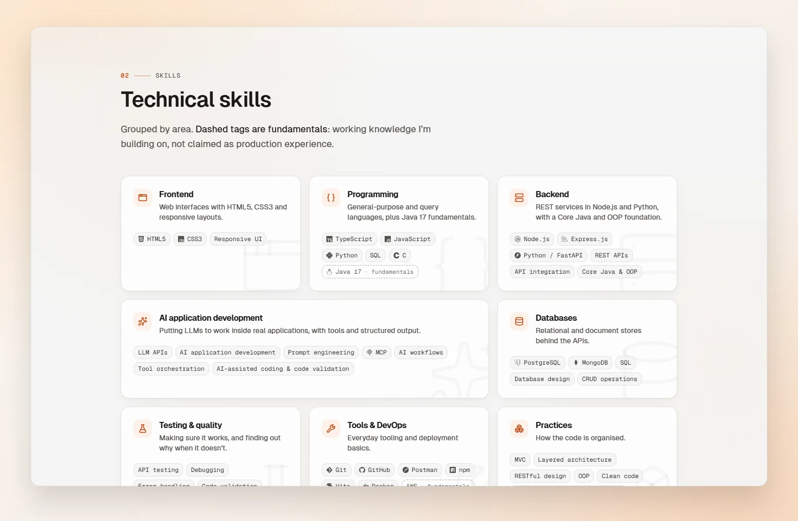
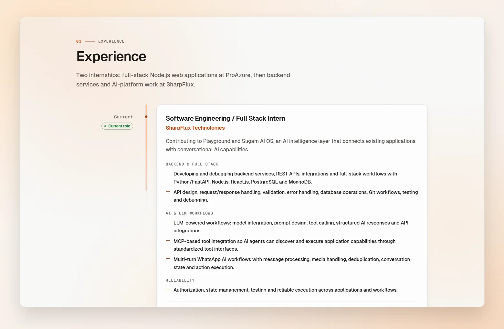
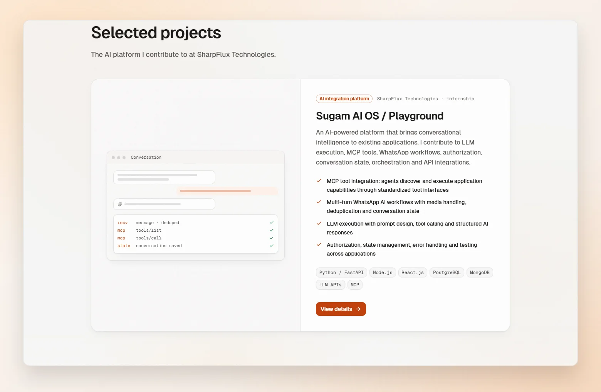
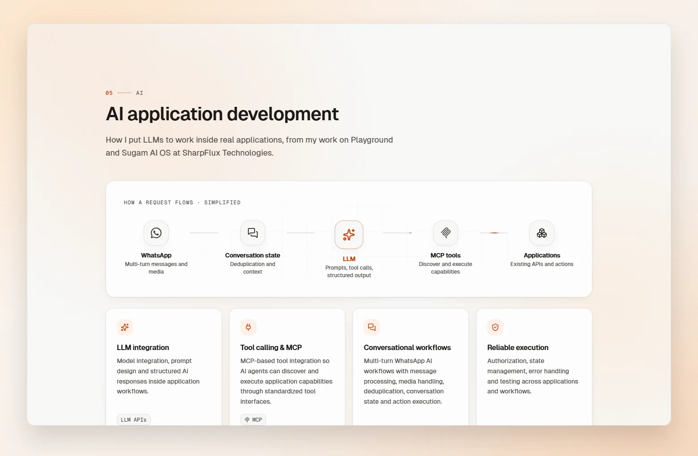
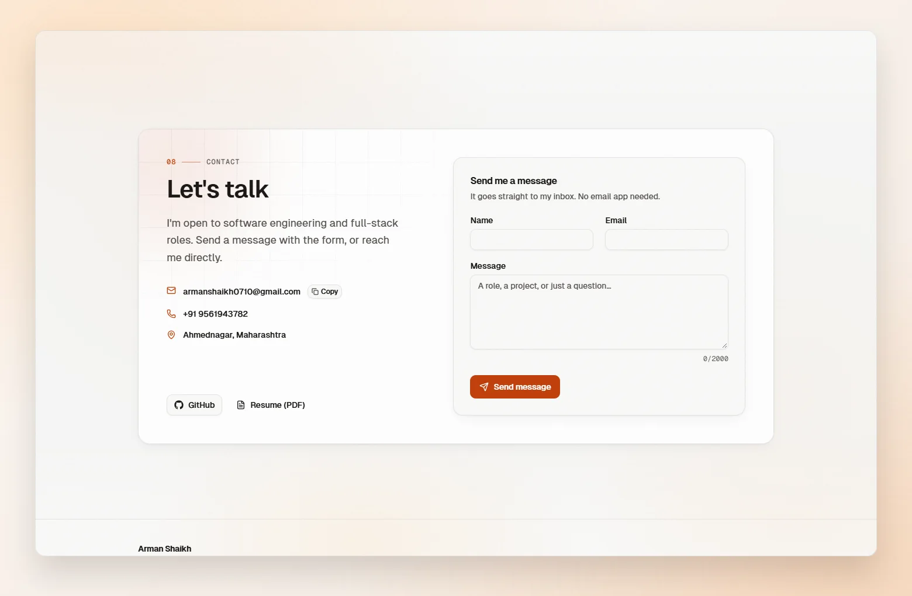
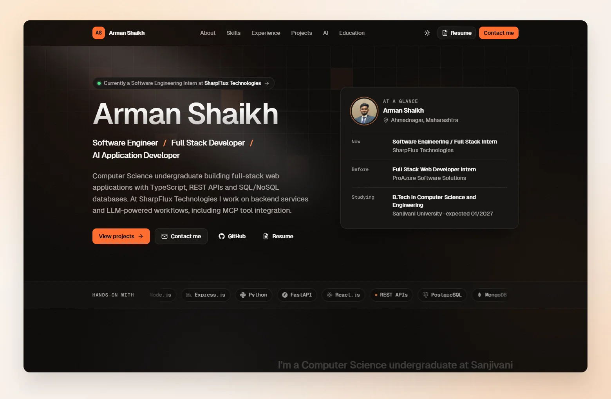
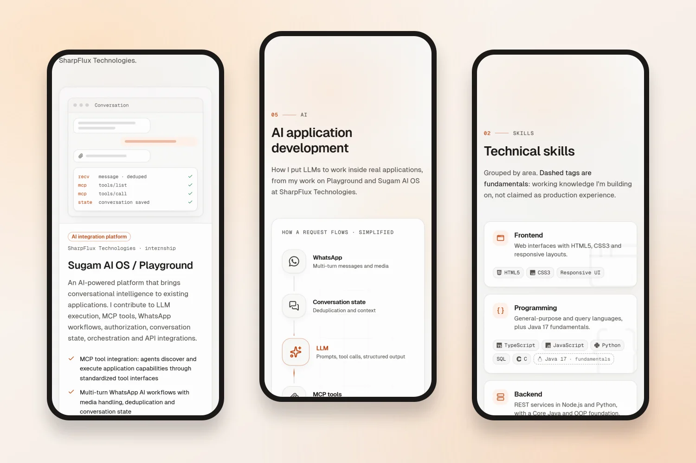

<div align="center">



<h1>Arman Shaikh</h1>

<p><strong>Software Engineer · Full Stack Developer · AI Application Developer</strong></p>

<p>
My personal portfolio: a light, motion-rich site built with React 19, TypeScript, Tailwind CSS v4 and shadcn/ui.<br />
Smooth scrolling, scroll-linked storytelling and careful micro-interactions, with every claim taken from my resume.
</p>

<p>
  
  
  
  
  
  
  
</p>

<p>
  <a href="public/Arman_Shaikh_ATS_Resume.pdf"><strong>Resume (PDF)</strong></a> ·
  <a href="https://github.com/Arman2125"><strong>GitHub</strong></a> ·
  <a href="mailto:armanshaikh0710@gmail.com"><strong>Email</strong></a>
</p>

</div>

---

## About me

I'm a Computer Science undergraduate at Sanjivani University (B.Tech, expected 01/2027) and a Software Engineering /
Full Stack Intern at **SharpFlux Technologies**, where I work on Playground and Sugam AI OS: backend services, REST
APIs, integrations and LLM-powered workflows with MCP tool integration. Before that, at **ProAzure Software
Solutions**, I built full-stack web applications with TypeScript and JavaScript on Node.js/Express REST APIs and
MongoDB.

This repository is the site that tells that story.

## Inside the site

The page reads top to bottom as one story, alternating plain and softly tinted sections:

| | Section | What it shows |
| --- | --- | --- |
| 00 | **Hero** | Name, roles, a short introduction and an "at a glance" card with the current role, education and location |
| 01 | **About** | An introduction that lights up word by word as you scroll, and how I work |
| 02 | **Skills** | Skills grouped by area (fundamentals marked as such) and a table of where each skill was actually used |
| 03 | **Experience** | A scroll-driven timeline of both internships |
| 04 | **Projects** | A case study of Sugam AI OS / Playground, the AI platform I contribute to at SharpFlux, with overview, features and architecture dialogs |
| 05 | **AI** | How a request flows through the AI workflows I work on: WhatsApp → conversation state → LLM → MCP tools → applications |
| 06 | **More work** | Earlier web projects and a link to the rest of my code |
| 07 | **Education** | Degrees and certifications |
| 08 | **Contact** | A working contact form, plus email, phone and resume |

## Motion and interaction



- **Smooth, weighted scrolling** on desktop with Lenis; native scrolling on touch devices.
- **Scroll-linked depth**: the hero's copy, card and grid move at different speeds as you leave it, and project
  previews drift against the scroll.
- **Reveals with rhythm**: section titles rise word by word, hairlines draw, tags cascade and check marks draw
  themselves, each played once.
- **An experience timeline** whose line fills as you scroll, lighting each role's node as it arrives.
- **Living project previews** that tilt toward the cursor with layered depth and play a short demo of the project's
  flow.
- **An animated AI pipeline** where light pulses travel from message to model to tools.
- **Micro-interactions**: magnetic buttons, cursor-following light, a scroll-aware header with a sliding active
  indicator, and a theme switch that opens as a circle from the toggle.

All of it is CSS plus a few small hooks: no animation library, no React re-renders while animating. Visitors who
prefer reduced motion get every section fully visible and still.

## Screenshots

<table>
  <tr>
    <td width="50%"></td>
    <td width="50%"></td>
  </tr>
  <tr>
    <td align="center"><sub><b>Skills</b>: grouped, with fundamentals marked honestly</sub></td>
    <td align="center"><sub><b>Experience</b>: a timeline that fills as you scroll</sub></td>
  </tr>
  <tr>
    <td width="50%"></td>
    <td width="50%"></td>
  </tr>
  <tr>
    <td align="center"><sub><b>Projects</b>: a case study with an interactive preview</sub></td>
    <td align="center"><sub><b>AI</b>: the request flow, animated</sub></td>
  </tr>
  <tr>
    <td width="50%"></td>
    <td width="50%"></td>
  </tr>
  <tr>
    <td align="center"><sub><b>Contact</b>: a form that works without a mail app</sub></td>
    <td align="center"><sub><b>Dark theme</b>: optional, from the toggle</sub></td>
  </tr>
</table>



## Engineering notes

- **Truthful by construction.** All content lives in one typed module (`src/data/resume.ts`) written from my resume.
  Skills listed as fundamentals render as dashed tags, the usage table only links a skill to work that names it, and
  tests fail on placeholder links or overclaimed skills.
- **Accessible.** Semantic landmarks, one `h1`, a skip link, visible focus rings, keyboard focus that follows in-page
  navigation, AA contrast in both themes and full `prefers-reduced-motion` support.
- **Fast.** About 149 KB of gzipped JavaScript, self-hosted fonts and a 6 KB hero photo. Scroll effects write
  transforms and CSS variables from cached positions, never measuring layout per frame; scrolling held a steady
  60 fps in testing on an Intel Iris Xe laptop.
- **Light first.** A warm stone and ember palette by design; the dark theme is opt-in.

The full write-up of the content model, design tokens and motion engine is in
[docs/ARCHITECTURE.md](docs/ARCHITECTURE.md).

## Built with

| Area | Tools |
| --- | --- |
| Framework | React 19, TypeScript (strict), Vite 8 |
| Styling | Tailwind CSS v4 with design tokens in CSS custom properties, tw-animate-css |
| Components | shadcn/ui on Radix UI primitives, Lucide icons |
| Motion | Lenis, a custom scroll and pointer engine, CSS keyframes and transitions, View Transitions API |
| Forms | Client-side validation, delivery through FormSubmit |
| Quality | Vitest, oxlint, `tsc --noEmit` |

## Getting started

Requires **Node.js 22** or newer.

```bash
git clone https://github.com/Arman2125/Arman-s-Portfolio.git
cd Arman-s-Portfolio
npm install
npm run dev
```

Then open http://localhost:5173.

| Command | What it does |
| --- | --- |
| `npm run dev` | Start the dev server with hot reload |
| `npm run build` | Typecheck, then build the static site into `dist/` |
| `npm run preview` | Serve the production build locally |
| `npm test` | Run the Vitest suite |
| `npm run lint` | Lint with oxlint |
| `npm run typecheck` | Run `tsc --noEmit` |

## Project structure

```
src/
  data/          resume.ts (all content), techIcons.ts (brand marks)
  components/
    sections/    one component per page section
    projects/    case studies, previews, details dialog, architecture diagram
    effects/     reveal, spotlight, marquee, magnetic, scroll-lit text, background atmosphere
    layout/      navbar, theme toggle, scroll progress, footer
    common/      section header, tech tags and logos
    ui/          shadcn/ui primitives
  lib/           scroll engine, pointer effects, motion helpers, theme, contact form logic
public/          resume PDF, favicon, hero photo
docs/            architecture notes and README screenshots
```

## Editing the content

Everything visible on the site comes from `src/data/resume.ts`: profile, skills, experience, projects, the AI
section, education and certifications. Replace `public/Arman_Shaikh_ATS_Resume.pdf` and
`public/images/arman-shaikh.webp` to update the resume download and the photo. Run `npm test` afterwards: the content
guards will catch placeholder links and skills claimed above the level the resume states.

## Deployment

`npm run build` produces a static site in `dist/` that any static host can serve (Vercel, Netlify, Cloudflare Pages
and similar). Assets are referenced from the site root, so serve it from a domain root or a custom domain rather than
a sub-path.

## Credits

- [shadcn/ui](https://ui.shadcn.com) and [Radix UI](https://www.radix-ui.com) for the component foundation
- [Magic UI](https://magicui.design) and [Aceternity UI](https://ui.aceternity.com) for the patterns behind several
  effects (blur fade, text reveal, animated beam, spotlight, magic card, marquee, border beam)
- [Lenis](https://lenis.darkroom.engineering) for smooth scrolling
- [Simple Icons](https://simpleicons.org) for brand marks (CC0); logos are trademarks of their respective owners
- [Geist](https://vercel.com/font) typefaces and [Lucide](https://lucide.dev) icons

<div align="center">
<sub>© 2026 Arman Shaikh</sub>
</div>
